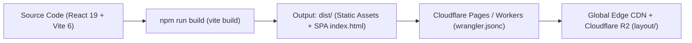

# Taka-Layout App (HCM-Layout) — System Architecture & Lookup Map

> 📌 **PURPOSE**: Fast lookup map for modules, services (`src/lib/`), hooks (`src/hooks/`), and components. **Never duplicate existing functions.**
> ⚡ **MAINTENANCE**: Preserve 100% module accuracy in **Telegraphic Imperative English** to minimize token usage.

## 1. 3-Layer Client-First & R2 Cloud Architecture (Zero Firebase)
`UI (React 19)` ⇄ `Layer 1: Zustand Stores (useAppStore.ts + DataContext.tsx, 0ms UI latency)` ⇄ `Layer 2: Local Cache (Dexie IndexedDB + CacheStorage + LocalStorage)` ⇄ `Layer 3: Cloudflare Edge (Pages Assets + Cloudflare R2 Auto-Load / Real-Time / Exit Auto-Save)`

---

## 2. Core Services Catalog (`src/lib/`) — Reuse Mandatory

### 2.1. Unified R2 Cloud Sync & Standalone Comparison (Option A)
| File | Key Exports | Purpose |
| :--- | :--- | :--- |
| `src/lib/r2UnifiedSyncService.ts` | `loadUnifiedDataFromCloudR2`, `syncAllDataToCloudR2`, `initAutoSaveOnAppClose`, `markWorkspaceDirty`, `subscribeR2SyncStatus`, `getR2SyncStatus` | **SSoT for R2 Cloud Sync**: Auto-loads full workspace from `layout/layout_config.json` on app open, merges floor partitions safely, syncs mutations in real time (`BroadcastChannel` + R2), and guards exit (`beforeunload`/`pagehide`/`visibilitychange`). |
| `src/lib/r2WorkspacePayloadService.ts` | `buildUnifiedWorkspacePayload`, `applyUnifiedWorkspacePayload`, `mergeRemoteAndLocalPayloads` | Serializes, hydrates, and smart-merges 100% workspace state (`storeLocationData`, `comparisonRows`, `projects`, `tasks`, `layoutSettings`, `paintCategoriesConfig`, `unitImagesMap`). |
| `src/lib/standaloneComparisonService.ts` | `downloadComparisonTemplate`, `importComparisonExcelOrCsvFile`, `hydrateSavedComparisonRows`, `exportFullStandaloneWorkspaceJson`, `importFullStandaloneWorkspaceJson`, `updateSavedComparisonRows` | **SSoT for Option A**: Lazy-loads `xlsx` on demand, parses Excel/CSV imports, matches unit codes with CAD shapes, persists to `localStorage` + R2 Cloud, and provides full workspace JSON backup & restore. |
| `src/lib/comparisonTemplateSpec.ts` | `ComparisonRowInput`, `SAMPLE_COMPARISON_DATA`, `COMPARISON_TEMPLATE_COL_WIDTHS` | Defines standard 35-column comparison template schema, sample rows, and Excel column widths. |
| `src/lib/layoutConfigCache.ts` | `getCachedLayoutConfigFromDisk`, `saveLayoutConfigToDisk`, `isValidLayoutConfig` | Multi-tier persistent local disk cache (`CacheStorage` + `IndexedDB` + `localStorage`) for 0ms instant boot. |
| `src/lib/unitSizeResolver.ts` | `getUnitEffectiveSizeM2`, `projectMatchesUnitCode` | Calculates effective area ($m^2$) from CAD/PDF drawn polygons (`UnitShape`) and normalizes unit codes for matching. |
| `src/lib/layoutDataAggregator.ts` | `aggregateLayoutData`, `computeUnitHeatmapColor` | Joins CAD floor polygons with business/schedule comparison records; computes area variance and status heatmaps. |

### 2.2. Canvas, Media & Storage Services
| File | Key Exports | Purpose |
| :--- | :--- | :--- |
| `src/lib/localDb.ts` | `localDb`, `TakaLocalDB` | Dexie IndexedDB storing floor plans, unit shape vectors, projects, tasks, and picture mapping pins for offline/instant boot. |
| `src/lib/r2StorageUtils.ts` | `uploadPictureToTakaFolder`, `deleteR2ImageCleanly`, `cleanOrphanR2Files` | Uploads and manages 360° panoramas and inspection photos on Cloudflare R2 with orphan cleanup. |
| `src/lib/imageCompression.ts` | `compressImageToWebp` | Client-side image compression (max 1920px, 0.82 quality) before storing or uploading. |
| `src/lib/zIndexManager.ts` | `getZIndexValue`, `getZIndexClass`, `useOverlayStack` | Centralized z-index layering (`MODAL_BASE`, `MODAL_MODULAR`, `CANVAS_OVERLAY`). |
| `src/lib/lazyWithRetry.ts` | `lazyWithRetry` | Dynamic `React.lazy` loader with chunk retry on network recovery. |
| `src/lib/firebaseStubs.ts` | Zero-op stubs | Build-time alias stub replacing `firebase/*` SDK (`0 KB` Firebase bundle footprint). |

---

## 3. Custom Hooks (`src/hooks/` & `*Parts/`)
| Hook | Path | Purpose |
| :--- | :--- | :--- |
| `useAppStore` / `useDataStore` | `src/store/useAppStore.ts`, `src/components/PictureMapping/DataContext.tsx` | Global Zustand states accessed via atomic selectors to eliminate re-renders. |
| `useLiveLayoutR2Config` | `src/components/LiveLayoutParts/useLiveLayoutR2Config.ts` | Hydrates 0ms local disk cache, revalidates R2 cloud config on mount, and resolves R2 signed URLs. |
| `useOffscreenImage` | `src/hooks/useOffscreenImage.ts` | Background-decodes high-resolution floorplan images for Konva canvas without blocking UI thread. |
| `useLayoutGestures` | `src/components/LayoutTabParts/useLayoutGestures.ts` | Handles pan, smooth zoom, pinch gestures, and coordinate normalization on floorplan canvas. |
| `useTableVirtualizer` | `src/hooks/useTableVirtualizer.ts` | High-performance row virtualizer for large comparison datasets. |

---

## 4. Feature-to-File Routing Map

| TabId | Primary Container | Key Submodules & Components | Modals & Overlays |
| :--- | :--- | :--- | :--- |
| **Header & App Shell** | `src/App.tsx` | `src/components/StandaloneHeader.tsx` (2-tab navigation + Option A Excel/JSON action bar + Live R2 Sync Status Badge) | `AppPrintStyles` |
| `layout` | `src/components/LayoutTab.tsx` | `LayoutTabParts/LayoutFloorKpiBar.tsx` (Floor KPI Scorecard + Dual-Metric Label + Fit `F` + PNG Snapshot) `LayoutTabParts/LayoutKonvaLayers.tsx` `LayoutTabParts/LayoutPaintCategoriesSection.tsx` | `LayoutEditModeModal.tsx` `LayoutDataIndexModal.tsx` (`LayoutDataIndexTable.tsx`) `LayoutUnitLightboxModal.tsx` |
| `picture_mapping` | `src/components/PictureMappingTab.tsx` | `PictureMapping/components/DataMapping/EditTab.tsx` `PictureMapping/components/DataMapping/DynamicHierarchyTab.tsx` `PictureMapping/components/DataMapping/ReviewTab.tsx` `PictureMapping/components/CloudSync/CloudSyncModal.tsx` | `DynamicCsvGuideModal.tsx` `EditTabInspector.tsx` |

---

## 5. Option A Comparison Data Contract

Comparison rows parsed by `src/lib/standaloneComparisonService.ts` conform to `ComparisonRowInput` in `src/lib/comparisonTemplateSpec.ts` (35 columns covering Identification, MD Status, Real-Time Project Schedule, and Financial/Sales/Margin metrics).

---

## 6. Build & Cloudflare Deployment Pipeline

- **Build Command**: `npm run build` (`vite build`)
- **Output Directory**: `dist`
- **Configuration**: Defined in `wrangler.jsonc` (`not_found_handling = "single-page-application"`)
- **Node Runtime**: Node 20.x or 22.x
