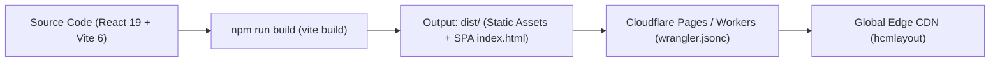

# Taka-Layout App (HCM-Layout) — System Architecture & Lookup Map

> 📌 **PURPOSE**: Fast lookup map for modules, services (`src/lib/`), hooks (`src/hooks/`), and components. **Never duplicate existing functions.**
> ⚡ **MAINTENANCE**: Preserve 100% module accuracy in **Telegraphic Imperative English** to minimize token usage.

## 1. 3-Layer Client-First Architecture
`UI (React 19)` ⇄ `Layer 1: Zustand Store (useAppStore.ts, 0ms UI latency)` ⇄ `Layer 2: Local Persistence (Dexie IDB + LocalStorage + Standalone JSON Backup)` ⇄ `Layer 3: Cloudflare Edge (Pages Assets + Cloudflare R2 / Optional Firebase)`

---

## 2. Core Services Catalog (`src/lib/`) — Reuse Mandatory

### 2.1. Standalone Comparison & Data Management (Option A)
| File | Key Exports | Purpose |
| :--- | :--- | :--- |
| `src/lib/standaloneComparisonService.ts` | `downloadComparisonTemplate`, `importComparisonExcelOrCsvFile`, `hydrateSavedComparisonRows`, `exportFullStandaloneWorkspaceJson`, `importFullStandaloneWorkspaceJson` | **SSoT for Option A**: Generates standard comparison Excel template, parses Excel/CSV imports, matches unit codes with CAD shapes, persists to `localStorage`, and provides full workspace JSON backup & restore. |
| `src/lib/unitSizeResolver.ts` | `getUnitEffectiveSizeM2`, `projectMatchesUnitCode` | Calculates effective area ($m^2$) from CAD/PDF drawn polygons (`UnitShape`) and normalizes unit codes for matching. |
| `src/lib/layoutDataAggregator.ts` | `aggregateLayoutData`, `computeUnitHeatmapColor` | Joins CAD floor polygons with business/schedule comparison records; computes area variance and status heatmaps. |

### 2.2. Canvas, Media & Storage Services
| File | Key Exports | Purpose |
| :--- | :--- | :--- |
| `src/lib/localDb.ts` | `localDb`, `TakaLocalDB` | Dexie IndexedDB storing floor plans, unit shape vectors, and picture mapping pins for offline/instant boot. |
| `src/lib/r2StorageUtils.ts` | `uploadPictureToTakaFolder`, `deleteR2ImageCleanly`, `cleanOrphanR2Files` | Uploads and manages 360° panoramas and inspection photos on Cloudflare R2 with orphan cleanup. |
| `src/lib/imageCompression.ts` | `compressImageToWebp` | Client-side image compression (max 1920px, 0.82 quality) before storing or uploading. |
| `src/lib/zIndexManager.ts` | `getZIndexValue`, `getZIndexClass`, `useOverlayStack` | Centralized z-index layering (`MODAL_BASE`, `MODAL_MODULAR`, `CANVAS_OVERLAY`). |
| `src/lib/lazyWithRetry.ts` | `lazyWithRetry` | Dynamic `React.lazy` loader with chunk retry on network recovery. |

---

## 3. Custom Hooks (`src/hooks/`)
| Hook | Path | Purpose |
| :--- | :--- | :--- |
| `useAppStore` / `useUISlice` / `useDataSlice` | `src/store/useAppStore.ts` | Global Zustand state accessed via atomic selectors to eliminate re-renders. |
| `useOffscreenImage` | `src/hooks/useOffscreenImage.ts` | Background-decodes high-resolution floorplan images for Konva canvas without blocking UI thread. |
| `useLayoutGestures` | `src/components/LayoutTabParts/useLayoutGestures.ts` | Handles pan, smooth zoom, pinch gestures, and coordinate normalization on floorplan canvas. |
| `useTableVirtualizer` | `src/hooks/useTableVirtualizer.ts` | High-performance row virtualizer for large comparison datasets. |

---

## 4. Feature-to-File Routing Map

| TabId | Primary Container | Key Submodules & Components | Modals & Overlays |
| :--- | :--- | :--- | :--- |
| **Header & App Shell** | `src/App.tsx` | `src/components/StandaloneHeader.tsx` (2-tab navigation + Option A Excel/JSON action bar) | `AppPrintStyles` |
| `layout` | `src/components/LayoutTab.tsx` | `LayoutTabParts/LayoutCanvasViewport.tsx`<br>`LayoutTabParts/LayoutUnitSidebar.tsx`<br>`LayoutTabParts/LayoutFilterToolbar.tsx`<br>`LayoutTabParts/LayoutFloorSelector.tsx` | `LayoutUnitLightboxModal.tsx`<br>`LayoutMiniGanttModal.tsx` |
| `picture_mapping` | `src/components/PictureMappingTab.tsx` | `PictureMapping/components/DataMapping/EditTab.tsx`<br>`PictureMapping/components/DataMapping/DynamicHierarchyTab.tsx`<br>`PictureMapping/components/DataMapping/ReviewTab.tsx`<br>`PictureMapping/components/DataMapping/EditTabParts/EditTabInspector.tsx` | `DynamicCsvGuideModal.tsx`<br>`EditTabInspector.tsx` |

---

## 5. Option A Comparison Data Contract

Comparison rows parsed by `src/lib/standaloneComparisonService.ts` conform to:

```typescript
export interface StandaloneComparisonRow {
  id: string;
  unitCode: string;          // Normalized unit code matching CAD polygon (e.g. "L1-01")
  brandName?: string;        // Tenant / Brand name
  zone?: string;             // Zone / Area (e.g. "Zone A", "Food Court")
  floor?: string;            // Floor identifier (e.g. "1F", "2F", "B1")
  category?: string;         // Business category (F&B, Retail, Fashion, Services)
  contractSizeM2?: number;   // Contracted lease area in m²
  cadSizeM2?: number;        // Automatically resolved from CAD/PDF UnitShape polygon
  sizeVarianceM2?: number;   // Variance: cadSizeM2 - contractSizeM2
  progressPercent?: number;  // Fit-out / Handover progress (0 - 100%)
  status?: string;           // "Planning" | "In Progress" | "Completed" | "Delayed"
  planStartDate?: string;    // YYYY-MM-DD
  planEndDate?: string;      // YYYY-MM-DD
  actualStartDate?: string;  // YYYY-MM-DD
  actualEndDate?: string;    // YYYY-MM-DD
  sales?: number;            // Sales revenue
  profit?: number;           // Net profit
  rentCost?: number;         // Lease / Rental cost
  notes?: string;            // Notes / Comments
  updatedAt: string;         // ISO timestamp
}
```

---

## 6. Build & Cloudflare Deployment Pipeline



- **Build Command**: `npm run build` (`vite build`)
- **Output Directory**: `dist`
- **Configuration**: Defined in `wrangler.jsonc` (`not_found_handling = "single-page-application"`)
- **Node Runtime**: Node 20.x or 22.x
